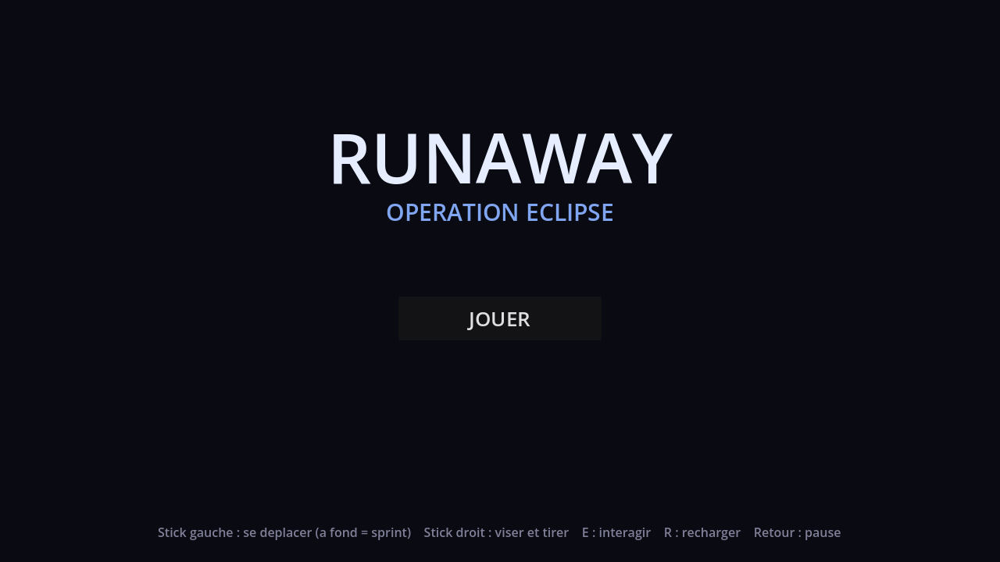
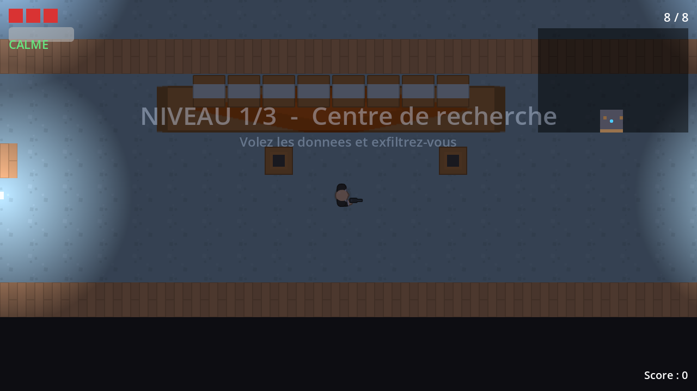
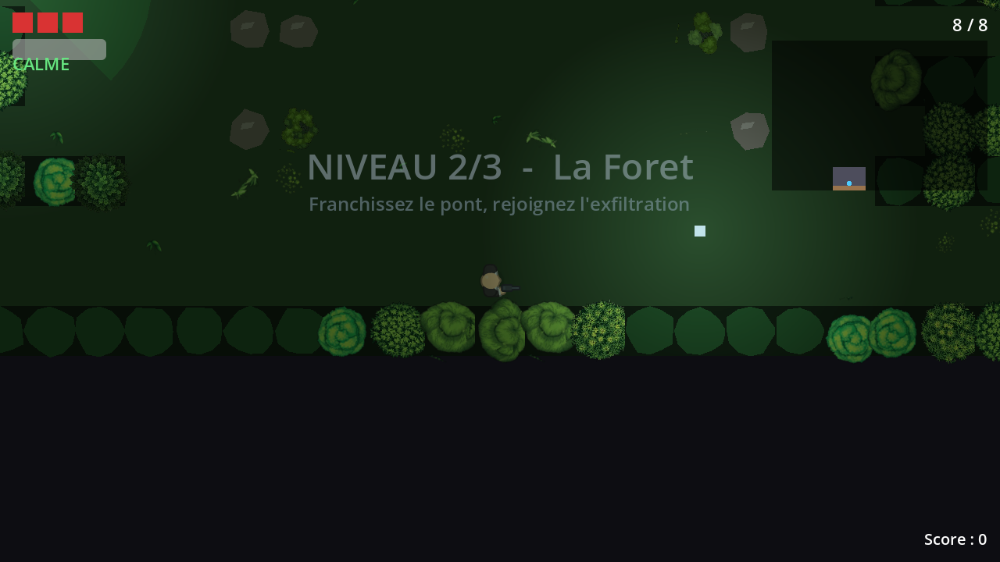
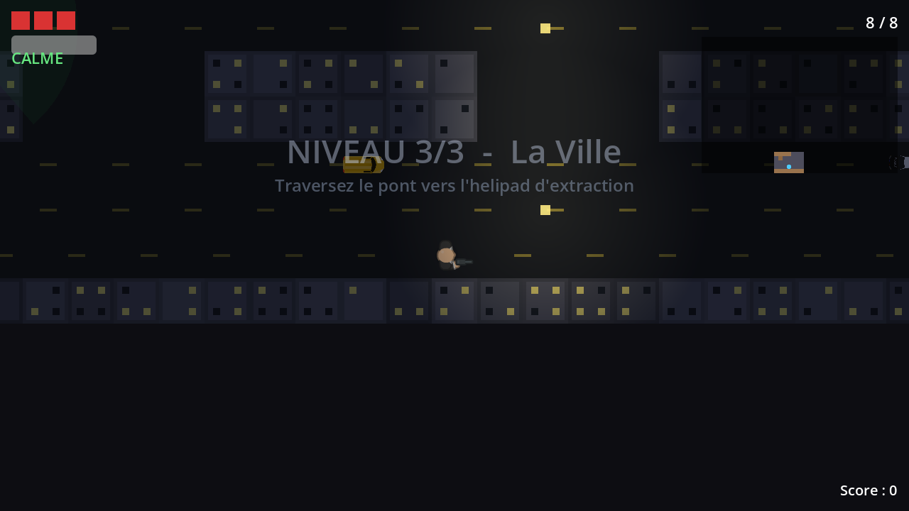
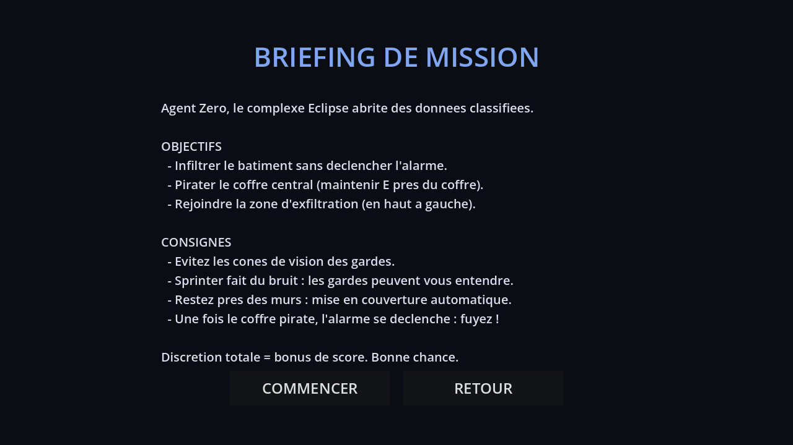

# RUNAWAY — Operation Eclipse

Un jeu d'infiltration vu de dessus. Vous etes l'Agent Zero : infiltrez le complexe
Eclipse, volez les donnees secretes, evitez les gardes et fuyez. Discret ou en force,
a vous de choisir.

Trois niveaux a la suite (un centre de recherche, une foret, une ville). Plus vous
restez discret et rapide, plus votre score grimpe.

---

## Comment jouer

Le but de chaque niveau est simple :

1. **Infiltrez-vous** sans entrer dans le champ de vision des gardes.
2. **Piratez le coffre** (approchez-vous et maintenez le bouton d'interaction).
3. **Fuyez vers la sortie** : une fois le coffre pirate, l'alarme sonne, foncez !

Quelques conseils :

- Les gardes voient devant eux dans un cone : passez derriere eux ou a couvert.
- Courir (sprint) fait du bruit et attire les gardes. Marchez pour rester discret.
- Tirer alerte tout le monde. Le silence rapporte plus de points.
- Vous avez 3 vies, un pistolet et des munitions a recharger.

## Installation

### Sur telephone Android

1. Recuperez le fichier **`RUNAWAY.apk`**.
2. Copiez-le sur votre telephone, puis ouvrez-le pour l'installer.
3. Si Android bloque l'installation, autorisez les *applications de sources inconnues*
   pour votre navigateur ou votre gestionnaire de fichiers, puis reessayez.
4. Lancez le jeu depuis l'icone RUNAWAY.

### Sur ordinateur (Windows / Linux)

Le jeu se lance avec le moteur gratuit **Godot 4.6.2** :

1. Telechargez Godot 4.6.2 sur le site officiel et ouvrez-le.
2. Importez ce dossier (selectionnez le fichier `project.godot`).
3. Appuyez sur **F5** pour jouer.

## Les commandes

### Sur telephone (ecran tactile)

| Pour...        | Faites...                                      |
| -------------- | ---------------------------------------------- |
| Vous deplacer  | Stick gauche (pousse a fond = vous courez)     |
| Viser et tirer | Stick droit                                    |
| Recharger      | Bouton `R` a l'ecran                           |
| Interagir      | Bouton `E` a l'ecran (maintenu)                |
| Mettre en pause| Bouton Retour du telephone                     |

### Sur ordinateur (clavier et souris)

| Pour...        | Faites...                       |
| -------------- | ------------------------------- |
| Vous deplacer  | `W` `A` `S` `D` ou les fleches  |
| Courir         | `Maj` (maintenu)                |
| Viser et tirer | Clic gauche                     |
| Recharger      | `R`                             |
| Interagir      | `E` (maintenu)                  |
| Mettre en pause| `Echap`                         |

## Apercu des niveaux

| Niveau 1 — Centre de recherche | Niveau 2 — La Foret |
| :----------------------------: | :-----------------: |
|  |  |

| Niveau 3 — La Ville | Briefing de mission |
| :-----------------: | :-----------------: |
|  |  |

## Ce qui rend le jeu special

- **Des gardes malins.** Ils anticipent vos mouvements, se repartissent pour vous
  encercler, evitent de se tirer dessus entre eux, entendent les coups de feu et
  fouillent l'endroit ou ils vous ont vu pour la derniere fois.
- **Un systeme d'alarme** en trois temps : Calme, Suspicion, Alerte.
- **Trois ambiances differentes** : interieur cloisonne, foret ouverte, ville de nuit.
- **Un score** qui recompense la discretion, la rapidite et la survie.
- **Jouable au clavier comme au tactile**, sans rien configurer.

## Pour les curieux (documentation)

Le dossier `docs/` contient deux documents detailles :

- `RUNAWAY_GDD_v4.pdf` — le document de conception complet du jeu.
- `RUNAWAY_GUIDE.pdf` — le guide complet (comment jouer, astuces de furtivite).

## Credits

- Graphismes et sons : **Kenney** (kenney.nl), libres d'utilisation (licence CC0).
- Moteur : **Godot Engine 4.6.2**.

---

Bonne infiltration, Agent Zero.
